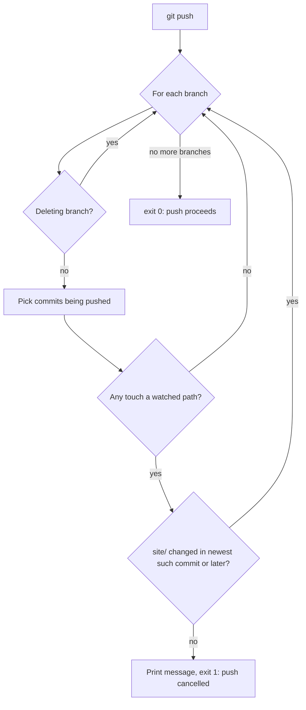

# Git hooks

This folder holds git hooks for this repo. There is currently one, `pre-push`,
which stops you pushing changes that affect the pkgdown website while the built
site in `site/` is out of date.

```sh
# Enable (once per clone)
git config core.hooksPath .githooks

# Bypass for a single push
git push --no-verify
```

The rest of this file explains how the hook works, line by line. It assumes no
prior knowledge of shell scripting or git internals. Each section builds on the
one before, so read it in order the first time. Self-check questions (with
answers) are at the end.

## 1. What is a git hook?

A hook is a script that git runs automatically at a particular moment. Its
filename says when: `pre-push` runs every time you `git push`, *before* anything
is sent to the remote (GitHub).

Git decides what to do based on the script's **exit code**:

| Exit code | Meaning | Git's response |
|---|---|---|
| `0` | success | push goes ahead |
| anything else | failure | push is cancelled |

**Why hooks must be enabled by hand.** Git never runs hooks just because they
are in a repository. Hooks can run any command, so if git ran them
automatically, cloning a stranger's repo and typing `git push` could run their
code on your machine. That is why each collaborator has to opt in with
`git config core.hooksPath .githooks`.

## 2. What problem does this hook solve?

The site in `site/` is built from inputs such as vignettes, `R/`, `man/`,
`NEWS.md` and the manuscript, by running `scripts/build-site.R`. If you change
an input but forget to rebuild, the published site is stale. The hook catches
this before the push.

The hook can only **guess** that the site is stale. It cannot compare the site
with what it *should* contain. It just notices that an input changed and
`site/` wasn't touched afterwards. Keep this limitation in mind (see
[section 7](#7-limitations-and-edge-cases)).

## 3. Git concepts you need first

The hook depends on a few ideas about how git stores history.

- **Commit**: a snapshot of the repo. Each commit has an ID called a **sha**, a
  40-character hexadecimal hash such as `3f2a9c1...`.
- **Parent**: every commit (except the very first one) records the commit that
  came before it. Following parents backwards gives the **history**:

  ```
  A <- B <- C <- D
  ```

  The arrows point backwards because each commit knows its parent, not its
  child.

- **Branch / ref**: a branch is just a *label pointing at one commit*. It is
  literally a small file, e.g. `.git/refs/heads/main`, containing one sha. Its
  full name, `refs/heads/main`, is called a **ref**.
- **Reachable**: commit X is reachable from Y if you can get from Y to X by
  following parent arrows. In the diagram above, A, B, C and D are all
  reachable from D.

> **Common misconception:** deleting a branch does *not* delete its commits.
> It only removes the label. The commits remain (possibly still reachable
> from other branches) until git eventually cleans up unreferenced ones.

### Commit ranges

`git rev-list` lists commits, newest first. It accepts *ranges*:

| Syntax | Meaning | With `A <- B <- C <- D` |
|---|---|---|
| `D` | everything reachable from D | A, B, C, D |
| `B..D` | reachable from D, **minus** reachable from B | C, D |
| `D --not --remotes` | reachable from D, **minus** reachable from any remote branch | see [section 5.3](#53-lines-1320-choosing-which-commits-to-inspect) |
| `C^` | the parent of C | B |
| `C^..D` | reachable from D, minus reachable from C's parent | C, D |

> **Common misconception:** `B..D` does *not* include B. The left-hand side is
> subtracted, so the range starts *after* it.

Two more `rev-list` options used by the hook:

- `-1`: return only the first (i.e. newest) result.
- `-- path1 path2 ...`: only list commits that changed at least one of these
  paths. The `--` separates commit arguments from file paths.

## 4. Shell syntax you need

The hook is written in plain POSIX `sh`, not bash, for portability. These are
the only constructs it uses:

| Syntax | Meaning |
|---|---|
| `#!/bin/sh` (line 1) | "shebang": tells the operating system which program runs this file. Not a comment. |
| `# ...` | comment |
| `name="value"` | assign a variable. **No spaces around `=`.** |
| `$name` | use a variable's value |
| `"$name"` | use the value as **one** argument, even if it contains spaces |
| `$name` (unquoted) | the value is **split at spaces** into several arguments |
| `$( command )` | run `command` and capture what it prints (like assigning a function's return value in R) |
| `[ A = B ]` | test: are strings A and B equal? Spaces inside brackets are required. |
| `[ -z "$x" ]` | test: is `$x` an empty string? |
| `X && Y` | run Y only if X succeeded (here: if the test was true) |
| `if ...; then ... else ... fi` | conditional; `fi` closes it |
| `while ...; do ... done` | loop while the condition succeeds |
| `read -r a b c` | read one line of input and split it at spaces into variables `a`, `b`, `c`. `-r` = "raw": treat backslashes literally. |
| `continue` | skip the rest of this loop iteration and go to the next |
| `echo "..."` | print a line |
| `exit N` | stop the whole script with exit code N |

## 5. Walkthrough

### 5.1 Lines 7–9: settings

```sh
watched="manuscripts/dh2027 vignettes R man _pkgdown.yml DESCRIPTION
README.md NEWS.md AGENTS.md CONTEXT.md TODO.md LICENSE.md"
zero=0000000000000000000000000000000000000000
```

`watched` lists the **inputs to the site**: anything pkgdown renders. Paths that
don't affect the site (`tests/`, `slurm-resources.yml`, `.githooks/`, ...) are
deliberately left out. If a site input were missing here, for example
`vignettes`, you would not be warned when you changed it.

`zero` is a fake sha that no real commit has. Git uses it to mean "no commit
here".

### 5.2 Line 11: what git sends the hook

```sh
while read -r local_ref local_sha remote_ref remote_sha; do
```

You don't run any command to produce these values. `git push` itself writes them
to the hook, one line per branch being pushed. It does this after checking where
the remote's branches currently are, but before sending anything. For
`git push origin feature`:

| Variable | Meaning | Example |
|---|---|---|
| `local_ref` | the local branch being pushed | `refs/heads/feature` |
| `local_sha` | the commit it points at on your machine | `F` |
| `remote_ref` | the branch on the remote that will be updated | `refs/heads/feature` |
| `remote_sha` | the commit that remote branch points at **now**, before the push | `B`, or `$zero` if it doesn't exist yet |

`remote_sha` is where the remote is now, and `local_sha` is where it will be if
the push succeeds. The commits between them are exactly what is being pushed.
The two ref names are normally identical. They differ only with something like
`git push origin feature:main`.

The loop runs once for each line, so once for each branch pushed.

### 5.3 Lines 13–20: choosing which commits to inspect

```sh
[ "$local_sha" = "$zero" ] && continue

if [ "$remote_sha" = "$zero" ]; then
  range="$local_sha --not --remotes"
else
  range="$remote_sha..$local_sha"
fi
```

There are three cases:

1. **Deleting a branch** (`git push origin --delete feature`): you are pushing
   "this label should point at nothing", so `local_sha` is zero. Nothing is
   being added, so the check is skipped (`continue`).
2. **Updating an existing branch**: the range is `remote_sha..local_sha`,
   meaning the commits you have that the remote branch doesn't. With the remote
   at B and you at D, that is C and D.
3. **Pushing a new branch**: the remote has no `remote_sha` for it, so the
   hook uses `local_sha --not --remotes` instead: everything reachable from
   your tip, minus everything reachable from *any* remote branch. For example:

   ```
   A <- B            origin/main   (the remote's main, as your clone knows it)
         \
          E <- F     feature       (new branch, pointing at F)
   ```

   `F --not --remotes` gives **E and F**. (F counts because it is reachable
   from itself.) The new *branch* isn't on the remote, but most of its
   *commits* (A, B) usually are, and those are subtracted.

**Why not just check everything reachable from F?** If a stale site already
existed in commits on the remote (say someone pushed with `--no-verify`), every
new branch built on them would be blocked for a problem it didn't create and
can't fix. Subtracting remote commits means the hook only judges *the commits
you are actually sending*, the same rule as case 2. It is also faster.

Note that `$range` holds several words (`F --not --remotes`). That's why it is
used **unquoted** on line 23: it must split into separate arguments.

### 5.4 Lines 23–24: the newest change to a site input

```sh
last=$(git rev-list -1 $range -- $watched)
[ -z "$last" ] && continue
```

In words: "among the commits being pushed, find the newest one that changed a
watched path, and store its sha in `last`". `$watched` is also unquoted on
purpose, so that it splits into separate paths.

If `last` is empty, none of the pushed commits touched a site input, so
(probably) no rebuild is needed and the hook moves to the next branch.

### 5.5 Line 27: was the site rebuilt since?

```sh
if [ -z "$(git rev-list -1 "$last^..$local_sha" -- site/)" ]; then
```

`"$last^..$local_sha"` means **`last` itself and every commit after it**, up to
the tip being pushed. `-- site/` keeps only commits that changed `site/`. If
that list is empty (`-z`), the site was never rebuilt after the latest input
change, so it is stale.

**Why `$last^..` rather than `$last..`?** Because `X..Y` excludes X. A common
workflow is to edit a vignette, rebuild, and commit both together in one
commit. With `$last..`, that commit would be excluded. Then, if your later
commits didn't touch `site/`, the hook would wrongly demand another rebuild.
Starting from the parent (`$last^`) keeps `last` in the range.

**Why only check the *newest* watched change (`-1` on line 23)?** A rebuild
always uses the *current* state of every input. A rebuild after the newest
change therefore also covers all the earlier ones, so earlier changes never need
checking.

### 5.6 Lines 28–36: reporting and exit code

```sh
    echo "pre-push: site/ is stale for $local_ref."
    ...
    exit 1
  fi
done
exit 0
```

If the site is stale, the hook prints which branch failed, the offending commit
(`git log -1 --format='%h %s'` prints a short sha and the commit message) and
how to fix it. Then it exits with `1`, which cancels the push.

`exit 1` is *inside* the loop, so it stops the script immediately. If you push
several branches and **any** is stale, the **whole push** is cancelled,
including the branches that were fine. Git does not do partial pushes after a
hook fails. `exit 0` on the last line is reached only if every branch passed.

## 6. The whole hook in one sentence

For each branch you push, find the newest commit you're sending that touched a
site input, and block the push unless `site/` was changed in that commit or a
later one.



## 7. Limitations and edge cases

- **It's a heuristic.** If a file the site depends on is missing from
  `watched`, changes to it go unnoticed. Conversely, *any* change to `site/`
  counts as a rebuild, even a partial or accidental one.
- **Repo's very first commit.** If `last` is the root commit, it has no parent,
  so `$last^` is invalid. Git prints `fatal: bad revision ...`, but only to the
  screen, not into `$( ... )`. The captured output is therefore empty, `-z` is
  true, and the hook reports a stale site even if that commit included a
  rebuild. This fails *safe* (a false alarm, not a missed problem). It can only
  happen on the first push of a brand-new repo, so it doesn't affect this one.
  Bypass with `--no-verify` if it ever comes up.
- **Bypassing.** `git push --no-verify` skips the hook entirely. Use it
  deliberately.

## 8. Self-check questions

Try answering before expanding each one.

<details>
<summary>1. Why doesn't git run hooks from a cloned repo automatically?</summary>

Hooks can run any code. Running them automatically would let anyone whose repo
you cloned run commands on your machine.
</details>

<details>
<summary>2. With history <code>A &lt;- B &lt;- C &lt;- D</code>, what does <code>git rev-list B..D</code> list?</summary>

C and D. B is excluded: the left side of `..` is subtracted.
</details>

<details>
<summary>3. When you delete a branch, are its commits deleted?</summary>

No. Only the label (ref) is removed. That's why the hook sees `local_sha` as
zero: you're pushing "point this label at nothing".
</details>

<details>
<summary>4. Are <code>local_sha</code> and <code>remote_sha</code> the same commit?</summary>

Usually not. `remote_sha` is where the remote branch is before the push;
`local_sha` is where it will be after. The commits between them are what is
being pushed.
</details>

<details>
<summary>5. For a new branch, why subtract <code>--remotes</code> instead of checking all of its history?</summary>

So the hook only judges commits you're actually sending. Otherwise a stale site
already on the remote would block every new branch built on it.
</details>

<details>
<summary>6. Why is <code>$range</code> unquoted on line 23, but <code>"$last^..$local_sha"</code> quoted on line 27?</summary>

`$range` may contain several arguments (`F --not --remotes`) that must be
split. The line 27 range is a single argument, and quoting it prevents any
accidental splitting.
</details>

<details>
<summary>7. You edit a vignette, rebuild the site, and commit both in one commit. Would the check pass with <code>$last..</code>? With <code>$last^..</code>?</summary>

With `$last..`, the commit containing the rebuild is excluded, so the hook
would wrongly block (unless a later commit also touched `site/`). With
`$last^..`, it's included, and the check passes.
</details>

<details>
<summary>8. Why is checking only the newest watched change enough?</summary>

A rebuild uses the current state of all inputs, so a rebuild after the newest
change covers every earlier one too.
</details>

<details>
<summary>9. You push two branches; one is stale. What happens?</summary>

The whole push is cancelled, including the good branch. `exit 1` stops the
script as soon as the stale branch is checked, whatever order the branches are
checked in.
</details>
