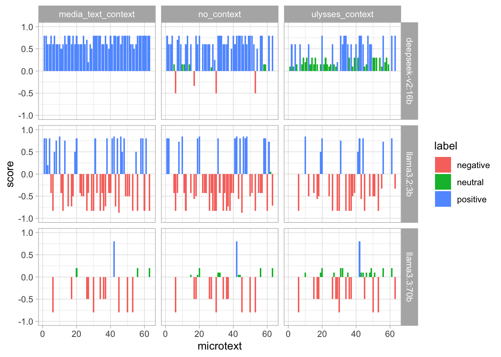
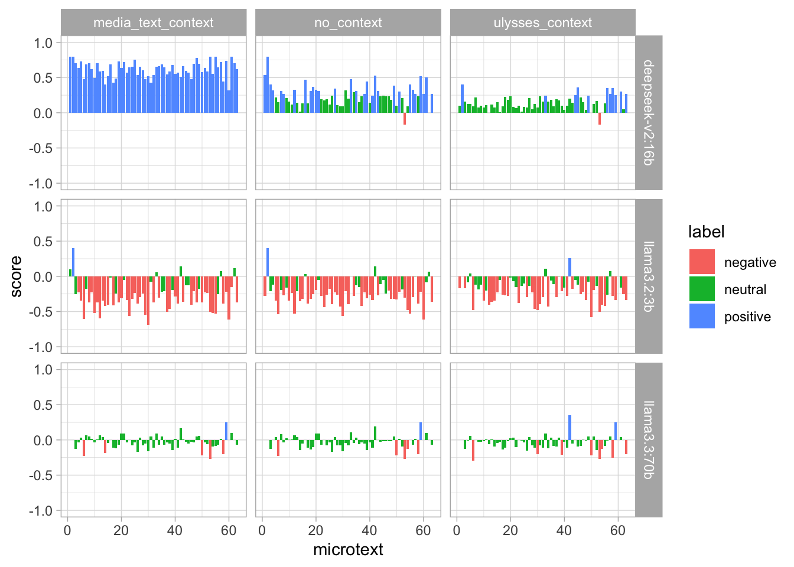
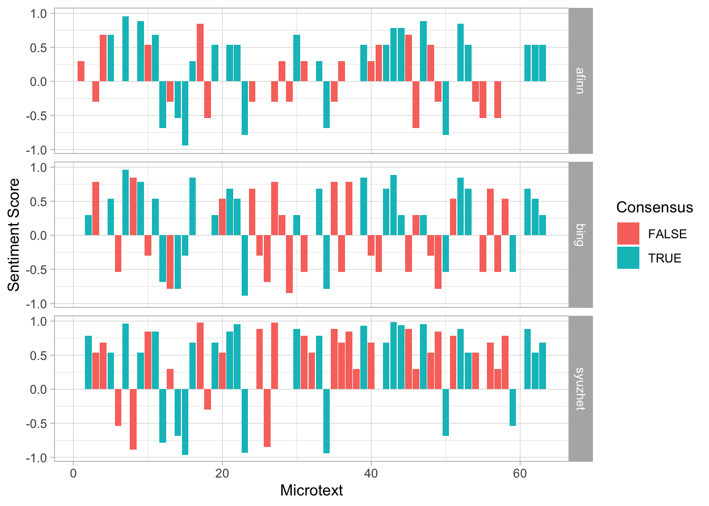
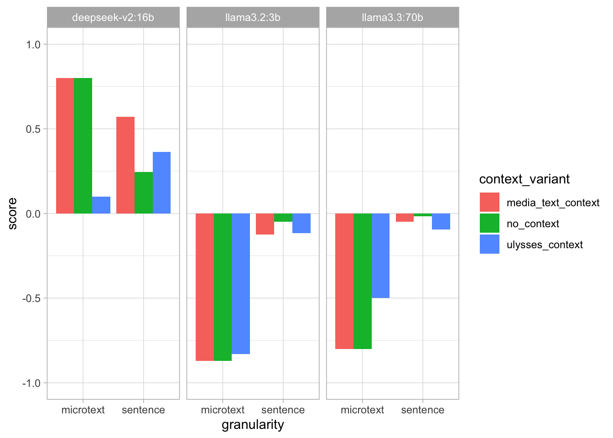
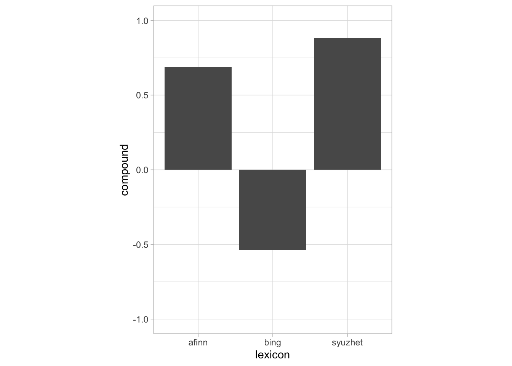
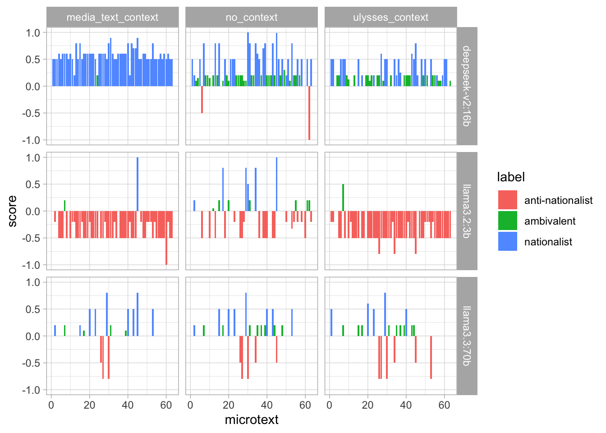
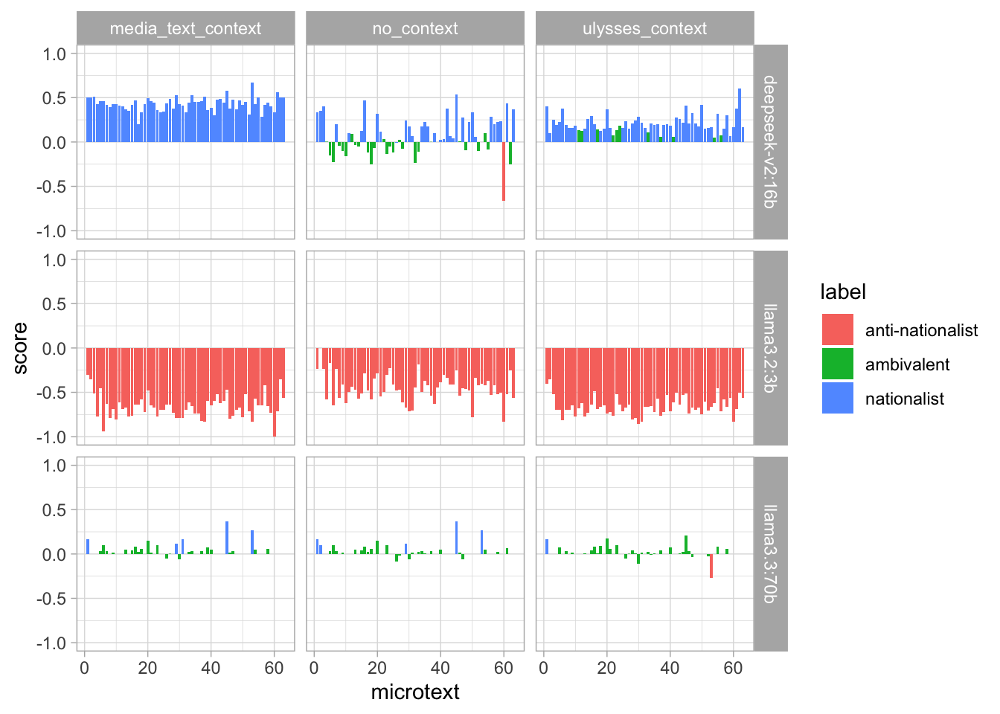
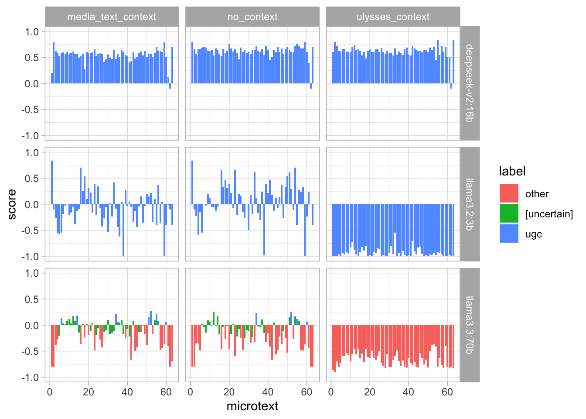
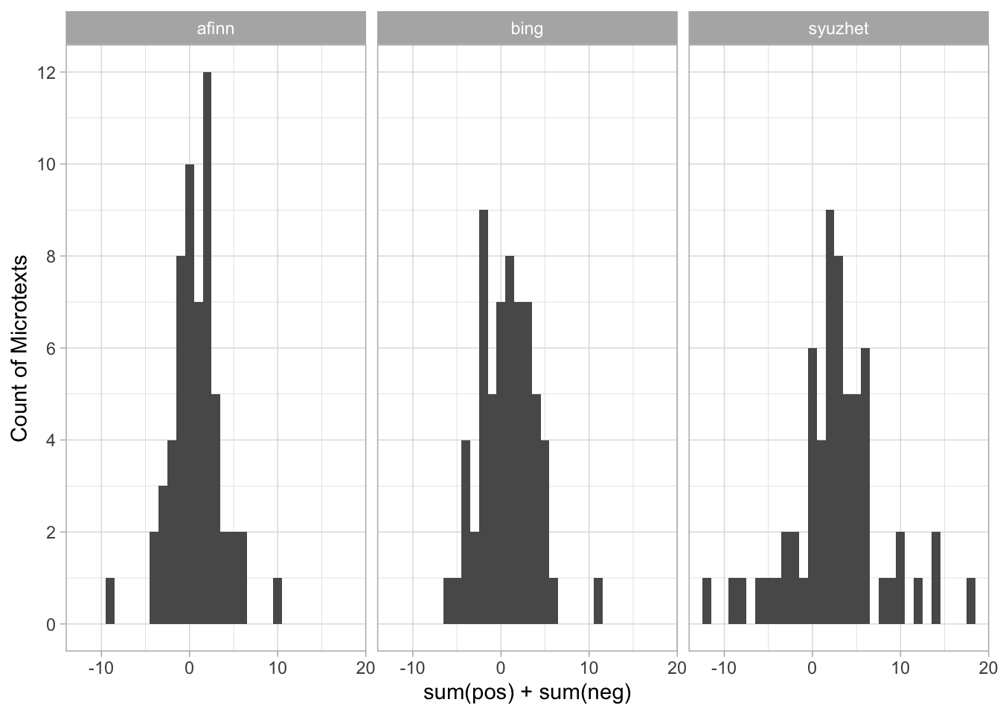

# 1 Introduction

# 1 Introduction

In \[1\]:

``` r
library(aeolusmicrotexts)
aeolus <- load_aeolus()
```

In this presentation, we report on our experiments performing
LLM-assisted close reading of the ‘Aeolus’ episode of James Joyce’s
*Ulysses*. The ‘Aeolus’ episode marks a crucial “hermeneutic shift” in
the novel ([Lawrence 1980, 392](#ref-lawrence_aeolus_1980)). In prior
episodes, the novel’s language is primarily transparent and referential,
as Joyce tries to create the illusion of a stream of consciousness; in
‘Aeolus’, new voices are introduced, in the form of newspaper headlines,
which interrupt the stream of consciousness and render the language
opaque. Who is speaking? Is there a consciousness behind the words?
Where is the divide between nature and artifice, between art and life?
This “hermeneutic shift” continues in later episodes of the novel, as
the language becomes increasingly opaque and self-referential.

Our aims in this paper are twofold:

> **Aim 1:** To try to discover new angles of interpretation with the
> assistance of LLMs.
>
> **Aim 2:** To try and determine best practices for open, reproducible
> literary-critical research using LLMs.

To pursue these aims, we choose to focus on “mediatization” in the
episode ([Schneider 1989](#ref-schneider_mediatization_1989)). The
episode takes place in a newspaper office, and the episode’s key
linguistic feature is the intrusion of newspaper headlines that
ironically label the action. We therefore analyse the language of the
episode as media discourse, using a traditional text-analytic technique
(lexicon-based sentiment analysis) and an LLM-assisted analogue of this
technique (LLM-based sentiment and thematic analysis).

This abstract is a quarto notebook. Code for all figures and
calculations can be viewed [on the research compendium
website](https://uom-digital-studies.github.io/aeolus-microtexts/dh2027/index-preview.html).

# 2 Literature Review

Like all episodes of *Ulysses*, ‘Aeolus’ has been subject to intense
analysis. For this presentation, we survey the literature on media
discourse in ‘Aeolus’. In a classic article, McLuhan
([1954](#ref-mcluhan_joyce_1954)) argues that *Ulysses* reflects the
temporal rhythms of the news media. Like a daily newspaper, Joyce’s
stream-of-consciousness technique realises “a continuous present for
events past, present and future” ([1954, 46](#ref-mcluhan_joyce_1954)).
McLuhan sees a deep harmony between the stream of consciousness and
media discourse in *Ulysses*. Subsequent scholars have reversed
McLuhan’s judgment. Lawrence ([1980](#ref-lawrence_aeolus_1980)),
Schneider ([1989](#ref-schneider_mediatization_1989)) and Radak
([2017](#ref-radak_aeolus_2017)) all argue that the newspaper headlines
in ‘Aeolus’ are intrusive, and disrupt the stream of consciousness.

We build on these readings in two ways. First, we re-adjudicate the
dispute between McLuhan and his followers. Is it really true that the
headlines are intrusive and disruptive, or do they in fact split the
chapter into rational units? Second, we consider ‘mediatization’ in a
new context, considering how the form of the chapter resonates with
contemporary social media.

To do this, we split ‘Aeolus’ on the headlines, converting the episode
into 63 “microtexts”. We study these microtexts as though they were
social media posts, to see if these reveals new patterns in the
language.

The principal analytic method we use is sentiment analysis, which was
originally developed for social media analysis, but has subsequently
become a crucial tool for plot analysis ([Elkins
2022](#ref-elkins_shapes_2022); [Franta and Silver
2024](#ref-franta_sentiment_2024); [Kim 2022](#ref-kim_sentiment_2022);
[Falk 2024, chap. 6](#ref-falk_romanticism_2024)). In this project, we
draw on recent research by Ornstein et al.
([2025](#ref-ornstein_how_2025)) and Mens and Gallego
([2025](#ref-mens_positioning_2025)) to formulate a reproducible
pipeline for LLM-based sentiment analysis, as explained below. For
comparison, we apply the afinn ([Nielsen 2011](#ref-nielsen_new_2011)),
bing ([Hu and Liu 2004](#ref-hu_mining_2004)) and syuzhet ([Jockers
2015](#ref-jockers_syuzhet_2015)) sentiment lexicons to Aeolus for
sentiment analysis, using Hutto and Gilbert
([2014](#ref-hutto_vader_2014))’s method for normalising the scores. As
we explain in [Section 3](#sec-methodology), LLMs have caused an
upheaval in sentiment analysis, allowing much more context-sensitive
data extraction at the cost of reliability and interpretability.

# 3 Methodology: The Reproducible Pipeline

LLMs are powerful but flawed tools for text analysis. In our view,
existing practices of open, reproducible scholarship are already
sufficient to realise much of the power while mitigating the flaws.

LLMs are powerful primarily because of *in-context learning* and
*structured outputs*. In-context learning is a powerful technique for
controlling the LLM’s response to data: the researcher provides
contextual clues in the prompt, enabling the LLM to respond more
sensitively to the input data ([Ornstein et al. 2025,
269](#ref-ornstein_how_2025)) Structured outputs make the output easier
to process, by ensuring that it conforms to a provided json schema
([“Structured Model Outputs OpenAI API,”
n.d.](#ref-openai_structured_data_docs)). This does not prevent
hallucinations, but does ensure that data is uniformly formatted for
processing.

They are flawed because they are inherently *inexplicable* and
*unreliable*. The problem of LLM explicability is well known ([Goebel et
al. 2018](#ref-goebel_explainable_2018)). LLMs have billions or
trillions of parameters that defy interpretation. Existing models have
no power of introspection, meaning that they can never give genuine
explanations of their own actions. The problem of LLM unreliability has
only recent been subject to serious research ([Barke and Murali
2026](#ref-barke_agents_2026); [Rabanser et al.
2026](#ref-rabanser_towards_2026)). Early research is not promising: as
LLMs have become more capable, they have not been getting more reliable.
Even as LLMs have become more capable, their consistency, robustness,
predictability, calibration and safety have hardly improved ([Rabanser
et al. 2026](#ref-rabanser_towards_2026)).

To address these flaws, we adopt the following principles for our
pipeline:

1.  *Run the analysis locally*: We use Ollama to run all LLM analysis
    locally, on NVidia A100 GPUS available on our University’s HPC
    cluster
2.  *Set temperature to 0*: When temperature is set to 0, LLMs become
    deterministic, always giving the same output to the same prompt.
3.  *Systematically vary the prompt and data*: Rather than interacting
    with the LLM in a chat environment to determine which prompt will
    work, we systematically run the analysis with different prompts and
    data structures, to assess what difference they make.
4.  *Make the pipeline fully reproducible*: When we run a set of
    experiments, full data are recorded for inspection by other
    scholars. All experimental data and LLM orchestration code are
    stored in a research compendium in the form of an installable R
    package.
5.  *Evaluate LLM analysis against other approaches*: Since the aim of
    our project is LLM-assisted close reading, we evaluate the LLM
    analysis against our own close reading of the text, supplemented
    with traditional, well-understood text analytic techniques (so far,
    lexicon-based sentiment analysis).

The data for the project is stored in a research compendium ([Marwick et
al. 2018](#ref-marwick_packaging_2018)), available at
<https://uom-digital-studies.github.io/aeolus-microtexts>. The
compendium contains an R package with our orchestration code,
experimental data from all successful runs, and our manuscripts.

At the time of this abstract, one set of experimental data is available
in the package ([Table 1](#tbl-list-runs)).

In \[2\]:

``` r
list_runs() |> knitr::kable()
```

In \[3\]:

| run_id | date | version | models |
|:---|:---|:---|:---|
| 20261019-131523_v0.2.0.9000 | 2026-10-19 13:15:23 | 0.2.0.9000 | llama3.2:3b , llama3.3:70b , deepseek-v2:16b |

Table 1: Available experimental ‘runs’ in `aeolusmicrotexts`

The results are stored in a long, self-describing format, to make their
inspection and replication simpler for other scholars
([Table 2](#tbl-result-schema)).

In \[4\]:

``` r
results <- read_run(run_id = "20261019-131523_v0.2.0.9000")
```

| column | meaning |
|----|----|
| `research_question` | Which research question is passed to the LLM: one of `"sentiment"` \| `"nationalism"` \| `"ugc"` |
| `model` | Name of the Ollama model that is passed to `ollama pull`, e.g. `"llama3.2:1b"` |
| `context_variant` | Which contextual clue is passed to the LLM: `"no_context"` (no information about where the text comes from), `"ulysses_context"` (LLM is told the text is from *Ulysses*), `"media_text_context"` (LLM is told that the text is social media text) |
| `granularity` | How ‘Aeolus’ is tokenised; it is either split into each `"microtext"`, or into each `"sentence"` |
| `include_headlines` | boolean; whether the headlines should be included in the corpus for analysis |
| `microtext` | Since the table has one row per unit, and each microtext could be split into multiple sentences, each row is labelled with the numeric id of each microtext. |
| `unit_index` | Since each microtext may be split into a sub-unit (the sentence), each row is labelled with a numeric index of the sub-unit (if `granularity == 'microtext'`), this is always `1`, since each microtext consists of 1 unit only. |
| `unit_of_analysis` | The exact text string sent to the LLM for this row’s classification call |
| `label` | The schema’s enum classification, e.g. `"positive"`, `"neutral"` and `"negative"` for the sentiment analysis schema. |
| `score` | The schema’s numeric score, always between -1 and 1 |

Table 2: Data schema for experimental results

As part of our research compendium, we provide a utility allowing
researchers to see exactly how the LLM is prompted. Since we run the
LLMs locally, we have full control over the exact prompt: it appears
that cloud providers sometimes modify user prompts without warning.
Below, we give an example of a prompt that would be sent to Ollama (with
the microtext truncated for space). We gave three tasks to the LLMs. In
the body of this abstract, we discuss only the first task, sentiment
analysis. Other results are shown in [Section 8.1](#sec-other-rqs).

In \[5\]:

``` r
preview_prompt(
  schema = sentiment_schema,
  context_variant = "ulysses_context",
  unit = " DEAR DIRTY DUBLIN

Dubliners.

—Two Dublin vestals, Stephen said, elderly and pious, 
have lived fifty and fiftythree years in Fumbally’s lane. [...]"
)
```

    ------------------------------------------------------------
    SYSTEM PROMPT (fixed instructions for experiment)
    ------------------------------------------------------------
    This text is from James Joyce's novel Ulysses. Classify the
    sentiment of this text as positive, neutral, or negative.

    ## Output fields

    Respond with a JSON object containing these fields, in this
    order.

    ### label
    Overall sentiment of the text.
    Allowed values: "positive", "neutral", "negative".

    ### score
    Sentiment intensity, from -1 (most negative) to 1 (most
    positive).
    Type: number.
    ------------------------------------------------------------
    USER TURN (datum for analysis)
    ------------------------------------------------------------
    ## The text

     DEAR DIRTY DUBLIN

    Dubliners.

    —Two Dublin vestals, Stephen said, elderly and pious,
    have lived fifty and fiftythree years in Fumbally’s lane.
    [...]
    ------------------------------------------------------------
    JSON SCHEMA (constrains output; not seen by model)
    ------------------------------------------------------------
    {
      "type": "object",
      "description": "Classify the sentiment of this text as
      positive, neutral, or negative",
      "properties": {
        "label": {
          "type": "string",
          "description": "Overall sentiment of the text",
          "enum": ["positive", "neutral", "negative"]
        },
        "score": {
          "type": "number",
          "description": "Sentiment intensity, from -1 (most
          negative) to 1 (most positive)"
        }
      },
      "required": ["label", "score"],
      "additionalProperties": false
    }

# 4 Initial Results

Our initial experiments were constrained by the software available on
our local HPC cluster. An old version of Ollama was installed, meaning
only certain models were available. Initial results are shown in
[Figure 1](#fig-microtext-granularity) and
[Figure 2](#fig-sentence-aggregation). For the experiments shown in
[Figure 1](#fig-microtext-granularity), the LLM was prompted with the
entire microtext each time, and asked to provide an overall label and
score. For [Figure 2](#fig-sentence-aggregation), the LLM graded each
sentence separately, and then the labels and scores were averaged for
each microtext.

In \[6\]:

``` r
# Templates for figures
llm_facetted_barplot <- function(data) {
  plot <- ggplot2::ggplot(data, ggplot2::aes(microtext, score, fill = label)) + 
    ggplot2::geom_col() + 
    ggplot2::facet_grid(
      rows = ggplot2::vars(model),
      cols = ggplot2::vars(context_variant)
    ) +
    ggplot2::ylim(-1, 1) + 
    ggplot2::theme_light()
  plot
}

# Need to give the factor labels in the right order in labels, so that 
# cut orders them from least to most negative
aggregate_sentences <- function(data) {
  data |> 
    dplyr::mutate(
      label = dplyr::case_match(
        label,
        "negative" ~ -1,
        "neutral"  ~ 0,
        "positive" ~ 1,
      )
    ) |> 
    dplyr::group_by(model, context_variant, microtext) |> 
    dplyr::summarise(
      label = mean(label),
      label = cut(label, breaks = c(-1, -.3, .3, 1), labels = c("negative", "neutral", "positive")),
      score = mean(score)
    )
}
```

In \[7\]:

``` r
results |> 
  dplyr::filter(granularity == "microtext", include_headlines == TRUE, research_question == "sentiment") |> 
  llm_facetted_barplot()
```

[](https://uom-digital-studies.github.io/aeolus-microtexts/dh2027/index_files/figure-html/fig-microtext-granularity-1.png "Figure 1: The three models disagreed substantially about the sentiments of many microtexts, and showed varying robustness to different prompts.")

Figure 1: The three models disagreed substantially about the sentiments
of many microtexts, and showed varying robustness to different prompts.

In \[8\]:

``` r
results |> 
  dplyr::filter(granularity == "sentence", include_headlines == TRUE, research_question == "sentiment") |>
  aggregate_sentences() |> 
  llm_facetted_barplot()
```

    Warning: There was 1 warning in `dplyr::mutate()`.
    ℹ In argument: `label = dplyr::case_match(...)`.
    Caused by warning:
    ! `case_match()` was deprecated in dplyr 1.2.0.
    ℹ Please use `recode_values()` instead.

    `summarise()` has regrouped the output.
    ℹ Summaries were computed grouped by model, context_variant, and microtext.
    ℹ Output is grouped by model and context_variant.
    ℹ Use `summarise(.groups = "drop_last")` to silence this message.
    ℹ Use `summarise(.by = c(model, context_variant, microtext))` for per-operation
      grouping (`?dplyr::dplyr_by`) instead.

[](https://uom-digital-studies.github.io/aeolus-microtexts/dh2027/index_files/figure-html/fig-sentence-aggregation-1.png "Figure 2: Segmenting the microtexts by sentence, then averaging the LLMs scores across sentences, produced substantially different results for all models.")

Figure 2: Segmenting the microtexts by sentence, then averaging the LLMs
scores across sentences, produced substantially different results for
all models.

The three models have remarkably different biases: `deepseek-v2:16b` has
a strong positive bias; `llama3.2:3b` tends to give extreme scores to
all texts; and `llama3.3:70b` is highly discriminative, giving extreme
scores to some texts and neutral scores to most.

The three models also vary in their response to the contextual clues.
For clarity, the three contextual clues injected into the prompt were:

- `media_text_context`: “This text is, or is intended to resemble,
  social media content.”
- `ulysses_context`: “This text is from James Joyce’s novel Ulysses.”
- `no_context`: \[No text injected to describe the text to be
  classified.\]

The three models also give remarkably different results based on the
segmentation of the text. This is also a problem in traditional
sentiment analysis, but to a much lesser degree. In traditional
sentiment analysis, each word is scored deterministically, and then the
researcher chooses how to aggregate the word-level scores. In LLM-based
sentiment analysis, the text is scored as a whole; different
segmentations lead to incommensurable scores, which are therefore hard
to aggregate.

All models showed some sensitivity to this changes, but
`deepseek-v2:16b` showed especial sensitivity. For example, when asked
to score each microtext as a complete unit, it never gave a negative
score except when no contextual clue was injected into the prompt.

# 5 Validation: Lexicon-based sentiment analysis

In \[9\]:

``` r
map_sentiments <- function(data, lexicon = c("bing", "afinn", "loughran", "syuzhet")) {
  # Assumes that `data` has a `word` column for matching
  lexicon <- rlang::arg_match(lexicon)
  sentiment_dictionary <- 
    if (lexicon == "syuzhet") {
      sentiment_dictionary <- syuzhet::get_sentiment_dictionary()
    } else {
      sentiment_dictionary <- tidytext::get_sentiments(lexicon)
    }
  # Add column
  data <- dplyr::left_join(
    data,
    sentiment_dictionary,
    by = dplyr::join_by(word)
  )
  # Remove numerical scores
  if ("value" %in% names(data)) {
    data <- dplyr::mutate(data, sentiment = dplyr::if_else(value > 0, "positive", "negative", NA))
    data <- dplyr::select(data, -value)
  }
  # Rename column
  lookup <- "sentiment"
  names(lookup) <- lexicon
  data <- dplyr::rename(data, dplyr::any_of(lookup))
  return(data)
}

classic_sentiment_analysis <- aeolusmicrotexts::load_aeolus(granularity = "microtext", include_headlines = TRUE) |> 
  tidytext::unnest_tokens(output = word, input = unit_of_analysis) |> 
  # Did not use loughran or nrc because they sort sentiments into too many categories
  map_sentiments("afinn") |> 
  map_sentiments("bing") |> 
  map_sentiments("syuzhet")

classic_sentiment_scores <- classic_sentiment_analysis |> 
  tidyr::pivot_longer(cols = c(afinn, bing, syuzhet), names_to = "lexicon", values_to = "score") |> 
  tidyr::drop_na() |> 
  dplyr::group_by(microtext, lexicon, score) |> 
  dplyr::tally() |> 
  dplyr::ungroup() |> 
  tidyr::pivot_wider(names_from = score, values_from = n, values_fill = 0) |> 
  dplyr::mutate(total = positive - negative)

normalised_scores <- classic_sentiment_scores |> 
  dplyr::mutate(compound = total / sqrt(total ^ 2 + 10)) |> 
  dplyr::mutate(consensus = all(compound > 0) | all(compound < 0), .by = microtext)
```

Like the LLM-analysis, the sentiment lexicons are inconsistent
([Figure 3](#fig-lexicon-scores); [Table 3](#tbl-consensus)). Overall,
the lexicons appear to agree most with `deepseek-v2:16b`, which is
however the least reliable of the LLMs that we tried, having the worst
calibration and prompt sensitivity. Despite this confusing overall
picture, however, the lexicon-based analysis has significant advantages
over the LLM-based analysis when we turn to close reading of the
passages, as we show in [Section 6](#sec-interpretation).

In \[10\]:

``` r
normalised_scores |> 
  ggplot2::ggplot(ggplot2::aes(x = microtext, y = compound, fill = consensus)) +
  ggplot2::geom_col() + 
  ggplot2::facet_grid(rows = ggplot2::vars(lexicon)) +
  ggplot2::theme_light() + 
  ggplot2::labs(
    x = "Microtext",
    y = "Sentiment Score",
    fill = "Consensus"
  )
```

[](https://uom-digital-studies.github.io/aeolus-microtexts/dh2027/index_files/figure-html/fig-lexicon-scores-1.png "Figure 3: The three sentiment lexicons disagree about the polarity of more than half the microtexts. Consensus means all three lexicons agree on the overall positivity or negativity of the microtext.")

Figure 3: The three sentiment lexicons disagree about the polarity of
more than half the microtexts. `Consensus` means all three lexicons
agree on the overall positivity or negativity of the microtext.

In \[11\]:

``` r
normalised_scores |> 
  dplyr::distinct(microtext, consensus) |> 
  dplyr::count(consensus) |> 
  dplyr::mutate(prop = n / sum(n)) |>
  dplyr::mutate(prop = scales::percent_format()(prop)) |> 
  dplyr::rename(
    Consensus = consensus,
    Microtexts = n,
    Proportion = prop
  ) |> 
  knitr::kable()
```

In \[12\]:

| Consensus | Microtexts | Proportion |
|:----------|-----------:|:-----------|
| FALSE     |         34 | 54.8%      |
| TRUE      |         28 | 45.2%      |

Table 3: The sentiment lexicons agree on fewer than half the microtexts.

# 6 Interpretation: Microtext \#45

In \[13\]:

``` r
microtext_llm_45 <- results |> 
  dplyr::filter(
    microtext == 45,
    granularity == "microtext", 
    include_headlines == TRUE, 
    research_question == "sentiment"
    ) |> 
  dplyr::select(model, granularity, context_variant, label, score)

sentence_llm_45 <- results |> 
  dplyr::filter(
    microtext == 45,
    granularity == "sentence", 
    include_headlines == TRUE, 
    research_question == "sentiment"
    ) |> 
  aggregate_sentences() |> 
  dplyr::mutate(granularity = "sentence") |> 
  dplyr::select(!microtext)
```

    `summarise()` has regrouped the output.
    ℹ Summaries were computed grouped by model, context_variant, and microtext.
    ℹ Output is grouped by model and context_variant.
    ℹ Use `summarise(.groups = "drop_last")` to silence this message.
    ℹ Use `summarise(.by = c(model, context_variant, microtext))` for per-operation
      grouping (`?dplyr::dplyr_by`) instead.

``` r
llm_plot <- dplyr::bind_rows(microtext_llm_45, sentence_llm_45) |> 
  ggplot2::ggplot(ggplot2::aes(x = granularity, y = score, fill = context_variant)) + 
  ggplot2::geom_col(position = "dodge") +
  ggplot2::facet_grid(cols = ggplot2::vars(model)) +
  ggplot2::ylim(-1, 1) + 
  ggplot2::theme_light()

lexicon_plot <- normalised_scores |> 
  dplyr::filter(microtext == 45) |> 
  ggplot2::ggplot(ggplot2::aes(x = lexicon, y = compound)) +
  ggplot2::geom_col() +
  ggplot2::ylim(-1, 1) +
  ggplot2::coord_fixed(2) +
  ggplot2::theme_light()
```

How can this analysis actually assist close reading? In this
presentation, we briefly consider the case of Microtext \#45
([Figure 4](#fig-close-reading)). \#45 is an especially interesting
section of ‘Aelous’ for two reasons. First, one of the characters
expresses—or rather quotes—virulent nationalist and anti-Semitic
sentiments. Second, it is the only part of *Ulysses* for which we
possess a recording in James Joyce’s voice.

``` r
# Generation code has been moved to @generate-close-reading-plots, because
# when the generation code was in this cell, it caused a downstream issue
# when quarto was rendering the qmd embeds.

llm_plot

lexicon_plot
```

[](https://uom-digital-studies.github.io/aeolus-microtexts/dh2027/index_files/figure-html/fig-close-reading-1.png "Figure 4 (a): LLM scores")

\(a\) LLM scores

[](https://uom-digital-studies.github.io/aeolus-microtexts/dh2027/index_files/figure-html/fig-close-reading-2.png "Figure 4 (b): Lexicon scores")

\(b\) Lexicon scores

Figure 4: Sentiment scores for Microtext \#45.

In our perspective, Microtext \#45 does not have a strong emotional
polarity. It certainly contains negative sentiments, but these are
refracted through quotation. The microtext has four main components: the
headline (“FROM THE FATHERS”); one character’s inner monologue
(Stephen’s); another character’s recitation of a nationalist,
anti-Semitic speech printed in the newspaper (J. J. O’Molloy reciting
John F. Taylor); and the narrator’s bemused comments on the action.

As we will show in the presentation, out initial LLM results give us few
clues about how to interpret the texture of this passage. They give the
entire microtext a score, without any clues as to what features of the
text have influenced the score. By contrast, the lexicon-based approach
immediately draws the reader’s attention to sentiment-laden words
([Table 4](#tbl-45-words)), which provides a basis for critical
discussion. Which words are identified as sentiment-laden? Is this
machine judgment reasonable in the context of the microtext? How do
these judgements prompt us to re-read the passage?

In \[14\]:

``` r
classic_sentiment_analysis |> 
  dplyr::filter(microtext == 45) |> 
  dplyr::filter(!is.na(afinn) | !is.na(bing) | !is.na(syuzhet)) |> 
  dplyr::group_by(word) |> 
  dplyr::mutate(n = dplyr::n()) |> 
  dplyr::slice_head(n=1) |> 
  dplyr::select(word, n, afinn, bing, syuzhet) |> 
  knitr::kable()
```

In \[15\]:

| word        |   n | afinn    | bing     | syuzhet  |
|:------------|----:|:---------|:---------|:---------|
| accept      |   1 | positive | NA       | positive |
| accepted    |   1 | positive | NA       | positive |
| admonition  |   1 | NA       | negative | negative |
| arrogant    |   1 | negative | negative | negative |
| awe         |   1 | NA       | positive | NA       |
| boldly      |   1 | positive | NA       | positive |
| bondage     |   1 | NA       | negative | negative |
| bowed       |   3 | NA       | NA       | negative |
| child       |   1 | NA       | NA       | positive |
| chosen      |   1 | NA       | NA       | positive |
| cloud       |   1 | NA       | negative | negative |
| combat      |   1 | negative | NA       | negative |
| corrupted   |   2 | NA       | negative | negative |
| cradle      |   1 | NA       | NA       | positive |
| culture     |   1 | NA       | NA       | positive |
| curse       |   1 | negative | negative | negative |
| dumb        |   1 | negative | negative | negative |
| effigy      |   1 | NA       | negative | NA       |
| enjoying    |   1 | positive | positive | positive |
| good        |   3 | positive | positive | positive |
| humanity    |   1 | NA       | NA       | positive |
| hunger      |   1 | negative | NA       | negative |
| idol        |   1 | NA       | positive | positive |
| inspiration |   1 | positive | positive | positive |
| laden       |   1 | NA       | NA       | negative |
| majestic    |   1 | NA       | positive | positive |
| mighty      |   1 | NA       | positive | positive |
| mysterious  |   1 | NA       | negative | negative |
| no          |   2 | negative | NA       | NA       |
| obscure     |   1 | NA       | negative | negative |
| outlaw      |   1 | NA       | negative | negative |
| pray        |   1 | positive | NA       | positive |
| priesthood  |   1 | NA       | NA       | positive |
| primitive   |   1 | NA       | negative | negative |
| saint       |   1 | NA       | positive | positive |
| shining     |   1 | NA       | NA       | positive |
| speech      |   1 | NA       | NA       | positive |
| spirit      |   1 | positive | NA       | positive |
| supple      |   1 | NA       | positive | positive |
| supremely   |   1 | NA       | positive | positive |
| terrible    |   1 | negative | negative | negative |
| weak        |   1 | negative | negative | negative |
| wealth      |   1 | positive | NA       | positive |
| youthful    |   1 | positive | positive | positive |

Table 4: The sentiment-laden words identified by the three lexicons in
Microtext \#45.

# 7 Conclusion: Next Steps

This is a work-in-progress presentation, so we conclude with our plans
for future work. We have 3 key plans:

1.  Repeat the experiments with larger and more recent LLMs, now that we
    have access to a more recent version of Ollama. We expect that
    larger and more capable models will be more reliable, though there
    are good reasons to doubt this.
2.  Include a “reasoning” field in the research question schemas, so
    that LLMs are obliged to provide a rationale for their scores. This
    may increase the interpretability of the results, thus making them
    more useful for close reading.
3.  Construct a dataset of human scores to for a third point of
    validation.
4.  Quantify our notions of “calibration,” “discrimination” and “prompt
    sensitivity” (adapting Rabanser et al.
    ([2026](#ref-rabanser_towards_2026))) to help develop a shared
    computational language for evaluating LLM research assistants.

In the long run, LLMs will only be useful for literary criticism if they
can be effectively harnessed to enrich our subjective experience of
texts. This new technology has not altered the fundamental aim of
algorithmic criticism: to “channel the heightened objectivity made
possible by the machine into the cultivation of those heightened
subjectivities necessary for critical work” ([Ramsay
2011](#ref-ramsay_reading_2011), ix).

# 8 Appendices

## 8.1 Appendix 1: Nationalism and User-Generated Content

In addition to sentiment analysis, we also performed thematic analysis
using the LLMs. Initial results are shown here for interest.

The second task we gave the LLMs was: Classify the nationalist
orientation of this text. Results were similar to the sentiment analysis
questions. All the models showed good calibration (the numerical score
corresponded to the label given by the model), but varied in their
prompt sensitivity and judgments.

In \[16\]:

``` r
results |> 
  dplyr::filter(granularity == "microtext", include_headlines == TRUE, research_question == "nationalism") |>
  dplyr::mutate(label = factor(label, levels = c("anti-nationalist", "ambivalent", "nationalist"))) |> 
  llm_facetted_barplot()
```

[](https://uom-digital-studies.github.io/aeolus-microtexts/dh2027/index_files/figure-html/fig-nationalism-microtext-1.png "Figure 5: The nationalism research question shows a similar distribution of results to the sentiment analysis question.")

Figure 5: The nationalism research question shows a similar distribution
of results to the sentiment analysis question.

In \[17\]:

``` r
results |> 
  dplyr::filter(granularity == "sentence", include_headlines == TRUE, research_question == "nationalism") |> 
  dplyr::mutate(
    label = dplyr::case_match(
      label,
      "anti-nationalist" ~ -1,
      "ambivalent"  ~ 0,
      "nationalist" ~ 1,
    )
  ) |> 
  dplyr::group_by(model, context_variant, microtext) |> 
  dplyr::summarise(
    label = mean(label),
    label = cut(label, breaks = c(-1, -.3, .3, 1), labels = c("anti-nationalist", "ambivalent", "nationalist"), include.lowest = TRUE),
    score = mean(score)
  ) |> 
  llm_facetted_barplot()
```

    `summarise()` has regrouped the output.
    ℹ Summaries were computed grouped by model, context_variant, and microtext.
    ℹ Output is grouped by model and context_variant.
    ℹ Use `summarise(.groups = "drop_last")` to silence this message.
    ℹ Use `summarise(.by = c(model, context_variant, microtext))` for per-operation
      grouping (`?dplyr::dplyr_by`) instead.

[](https://uom-digital-studies.github.io/aeolus-microtexts/dh2027/index_files/figure-html/fig-nationalism-sentence-1.png "Figure 6: As with sentiment analysis, analysing by sentence and then aggregating produces starkly different results.")

Figure 6: As with sentiment analysis, analysing by sentence and then
aggregating produces starkly different results.

The third task we gave the LLMs was: Judge the resemblance of this text
to typical user-generated content. Here the two smaller models failed.
Their calibration was maximally poor: they labelled every microtext as
“ugc” even if awarding a negative score. This poor calibration was
repeated when the LLMs analysed the microtexts on the sentence level.
The larger model showed good calibration and discrimination: the
‘Aeolus’ episode comments ironically on media discourse; the actual
fabric of the episode, with its dialogue and streams of consciousness,
rarely resembles media discourse on the surface.

The poor results may have been the fault of our research question
schema. Due to an oversight, the LLM was only given two labels to choose
from: `"ugc"` and `"other"`. There was no third label for results in the
middle of the scale. Since in our setup, the LLM outputs the label
before it outputs the numerical score, the numerical score directly
depends on the label. It is surprising that the calibration between
score and label was so poor on two of the models despite this.

In \[18\]:

``` r
results |> 
  dplyr::filter(granularity == "microtext", include_headlines == TRUE, research_question == "ugc") |> 
  dplyr::mutate(label = factor(label, levels = c("other", "[uncertain]", "ugc"))) |> 
  llm_facetted_barplot() +
  ggplot2::scale_fill_discrete(drop=FALSE)
```

[](https://uom-digital-studies.github.io/aeolus-microtexts/dh2027/index_files/figure-html/fig-ugc-microtexts-1.png "Figure 7: Results from the “user-generated content” question are meaningless. NB: due to a flaw in our code, the LLM was only provided two possible labels, unlike for the other questions.")

Figure 7: Results from the “user-generated content” question are
meaningless. NB: due to a flaw in our code, the LLM was only provided
two possible labels, unlike for the other questions.

In \[19\]:

``` r
results |> 
  dplyr::filter(granularity == "sentence", include_headlines == TRUE, research_question == "ugc") |>
  dplyr::mutate(
    label = dplyr::case_match(
      label,
      "other" ~ -1,
      "ugc" ~ 1,
    )
  ) |> 
  dplyr::group_by(model, context_variant, microtext) |> 
  dplyr::summarise(
    label = mean(label),
    label = cut(label, breaks = c(-1, -.3, .3, 1), labels = c("other", "[uncertain]", "ugc"), include.lowest = TRUE),
    score = mean(score)
  ) |> 
  llm_facetted_barplot()
```

    `summarise()` has regrouped the output.
    ℹ Summaries were computed grouped by model, context_variant, and microtext.
    ℹ Output is grouped by model and context_variant.
    ℹ Use `summarise(.groups = "drop_last")` to silence this message.
    ℹ Use `summarise(.by = c(model, context_variant, microtext))` for per-operation
      grouping (`?dplyr::dplyr_by`) instead.

[](https://uom-digital-studies.github.io/aeolus-microtexts/dh2027/index_files/figure-html/fig-ugc-sentences-1.png "Figure 8: Sentence-level analysis also displays very poor calibration on the smaller models. Note that the ‘[uncertain]’ label has been imputed from the aggregated sentence-level scores.")

Figure 8: Sentence-level analysis also displays very poor calibration on
the smaller models. Note that the ‘\[uncertain\]’ label has been imputed
from the aggregated sentence-level scores.

## 8.2 Appendix 2: Normalising the lexicon-based sentiment scores.

The LLMs were asked to score the microtexts between -1 and 1 on all
three tasks. To compare these LLM scores with the lexicon-based scores,
we therefore converted the lexicon-based scores to a numerical scale. We
adapted the method of Hutto and Gilbert ([2014](#ref-hutto_vader_2014)),
shown in [Equation 1](#eq-vader-normalisation).

\\\[ compound = \frac{sum(pos) + sum(neg)}{\sqrt{(sum(pos) +
sum(neg))^2 + \alpha}} \tag{1}\\\]

Where \\(pos\\) is the sum of positively-scored words in the text,
\\(neg\\) is the sum of negatively-scored words, and \\(\alpha\\) is the
expected maximum score for a given text. VADER gives a score between -4
and 4 for each word, and is calibrated to short social media texts such
as tweets. They empirically determined \\(\alpha\\) to be \\(15\\).
Since two of our lexicons, *bing* and *afinn*, simply give a text label
to each word (`"positive"` or `"negative"`), we determined \\(\alpha\\)
differently. We convert the labels to a \\(-1\\) and \\(1\\), and then
inspect the distribution ([Figure 9](#fig-classic-scores-dist)).
Although *syuzhet* occasionally returns more extreme scores, we
determine \\(10\\) as the most appropriate value for \\(\alpha\\) on our
scale.

In \[20\]:

``` r
classic_sentiment_scores |> 
  ggplot2::ggplot(ggplot2::aes(x = total)) + 
  ggplot2::geom_histogram(binwidth = 1) + 
  ggplot2::facet_wrap(ggplot2::vars(lexicon)) +
  ggplot2::labs(
    x = "sum(pos) + sum(neg)",
    y = "Count of Microtexts"
  ) +
  # y-axis should have integer breaks: discrete!
  ggplot2::scale_y_continuous(breaks = scales::breaks_pretty()) +
  ggplot2::theme_light()
```

[](https://uom-digital-studies.github.io/aeolus-microtexts/dh2027/index_files/figure-html/fig-classic-scores-dist-1.png "Figure 9: Most texts achieve a score between -10 and 10 on inspection of the histogram.")

Figure 9: Most texts achieve a score between -10 and 10 on inspection of
the histogram.

# 9 AI Declaration

We used Posit Assistant to assist writing the orchestration code and to
document our design decisions for the research compendium. All
agent-facing documentation is available in the Github repository for
this project in the `docs/` directory or the project root. The code in
this abstract was hand-written, with occasional recourse to AI to help
identify bugs. All code in the project, whether handwritten or drafted
with AI assistance, has been reviewed line-by-line by a human, and we
take full responsibility for every line.

All prose in this abstract was human-authored without exception.

# 10 References

Barke, Shraddha, and Adithya Murali. 2026. “Agents as Software: A
Programming Languages Agenda for Agent Reliability.” *Proceedings of the
2026 ACM SIGPLAN International Symposium on New Ideas, New Paradigms,
and Reflections on Programming and Software* (New York, NY, USA),
Onward! ’26, October, 179–90. <https://doi.org/10.1145/3840586.3843744>.

Elkins, Katherine. 2022. *The Shapes of Stories: Sentiment Analysis for
Narrative*. Cambridge University Press.
<https://doi.org/10.1017/9781009270403>.

Falk, Michael. 2024. *Romanticism and the Contingent Self: The Challenge
of Representation*. Palgrave Studies in the Enlightenment, Romanticism
and Cultures of Print. Springer International Publishing.
<https://doi.org/10.1007/978-3-031-49959-3>.

Franta, Andrew, and Sean Silver. 2024. “Sentiment Analysis and the
Sentimental Novel.” *Critical Inquiry* 50 (3): 402–24.
<https://doi.org/10.1086/728948>.

Goebel, Randy, Ajay Chander, Katharina Holzinger, et al. 2018.
“Explainable AI: The New 42?” In *Machine Learning and Knowledge
Extraction*, edited by Andreas Holzinger, Peter Kieseberg, A Min Tjoa,
and Edgar Weippl. Lecture Notes in Computer Science. Springer
International Publishing.
<https://doi.org/10.1007/978-3-319-99740-7_21>.

Hu, Minqing, and Bing Liu. 2004. “Mining and Summarizing Customer
Reviews.” *Proceedings of the Tenth ACM SIGKDD International Conference
on Knowledge Discovery and Data Mining* (New York, NY, USA), KDD ’04,
August, 168–77. <https://doi.org/10.1145/1014052.1014073>.

Hutto, C., and Eric Gilbert. 2014. “VADER: A Parsimonious Rule-Based
Model for Sentiment Analysis of Social Media Text.” *Proceedings of the
International AAAI Conference on Web and Social Media* 8 (1): 216–25.
<https://doi.org/10.1609/icwsm.v8i1.14550>.

Jockers, Matthew. 2015. *Syuzhet: Extract Sentiment and Plot Arcs from
Text*. <https://github.com/mjockers/syuzhet>.

Kim, Hoyeol. 2022. “Sentiment Analysis: Limits and Progress of the
Syuzhet Package and Its Lexicons.” *Digital Humanities Quarterly* 016
(2).

Lawrence, Karen R. 1980. “"Aeolus": Interruption and Inventory.” *James
Joyce Quarterly* 17 (4): 389–405.
<https://www.jstor.org/stable/25476319>.

Marwick, Ben, Carl Boettiger, and Lincoln Mullen. 2018. “Packaging Data
Analytical Work Reproducibly Using R (and Friends).” *The American
Statistician* 72 (1): 80–88.
<https://doi.org/10.1080/00031305.2017.1375986>.

McLuhan, Marshall. 1954. “Joyce, Mallarmé, and the Press.” *The Sewanee
Review* 62 (1): 38–55. <https://www.jstor.org/stable/27538333>.

Mens, Gaël Le, and Aina Gallego. 2025. “Positioning Political Texts with
Large Language Models by Asking and Averaging.” *Political Analysis* 33
(3): 274–82. <https://doi.org/10.1017/pan.2024.29>.

Nielsen, Finn Årup. 2011. “A New ANEW: Evaluation of a Word List for
Sentiment Analysis in Microblogs.” *CoRR* abs/1103.2903.
<https://doi.org/10.48550/ARXIV.1103.2903>.

Ornstein, Joseph T., Elise N. Blasingame, and Jake S. Truscott. 2025.
“How to Train Your Stochastic Parrot: Large Language Models for
Political Texts.” *Political Science Research and Methods* 13 (2):
264–81. <https://doi.org/10.1017/psrm.2024.64>.

Rabanser, Stephan, Sayash Kapoor, Peter Kirgis, Kangheng Liu, Saiteja
Utpala, and Arvind Narayanan. 2026. *Towards a Science of AI Agent
Reliability*. arXiv. <https://doi.org/10.48550/arXiv.2602.16666>.

Radak, Tamara. 2017. “"Aeolus”, Interrupted: Heady Headlines and Joycean
Negotiations of Closure.” In *Publishing in Joyce’s *Ulysses**, edited
by William Brockman, Tekla Mecsnóber, and Sabrina Alonso. BRILL.
<https://doi.org/10.1163/9789004359062_011>.

Ramsay, Stephen. 2011. *Reading Machines: Towards an Algorithmic
Criticism*. University of Illinois Press.

Schneider, Ulrich. 1989. “Mediatization in "Aeolus" and "Oxen of the
Sun".” *European Joyce Studies* 1: 15–21.
<https://www.jstor.org/stable/44871172>.

“Structured Model Outputs OpenAI API.” n.d. In *OpenAI Developers*.
Accessed November 11, 2026.
<https://developers.openai.com/api/docs/guides/structured-outputs>.
